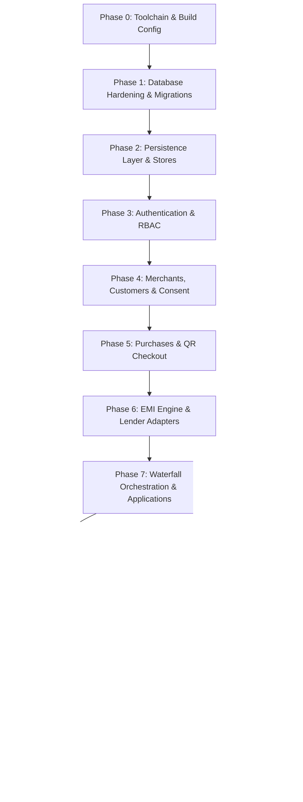

# Udhyam PAY — Incremental Implementation Plan

**Target Architecture:** Modular Monolith (Express 5 + Prisma 6 + PostgreSQL 16 + TypeScript 5)  
**Security Standard:** RBI Digital Lending Compliance & DPDP Act Alignment  
**Financial Precision:** Integer Paise Arithmetic (`BigInt`), Zero Floating-Point Currency Math  

---

## Plan Overview & Phasing Strategy

To safely elevate Udhyam PAY from its current Foundation Skeleton (Phase 1) to a production-ready, fully verified multi-lender financing orchestration backend, implementation is divided into **12 sequential, test-driven phases**. Each phase is self-contained, builds strictly upon prior phases, and enforces strict acceptance criteria.



---

## Phase 0: Toolchain, Dependencies & Build Hardening

- **Priority:** P0 (Critical Blocker)
- **Objective:** Fix dependency declarations, TypeScript module resolution, and package lockfile so that tests and builds can execute cleanly.

### Tasks
1. **Declare Missing Dependencies in `package.json`:**
   - Add `argon2` (^0.41.0)
   - Add `jose` (^5.9.0)
   - Add `qrcode` (^1.5.4) and `@types/qrcode` (^1.5.5)
   - Add `"type": "module"` to `package.json`
2. **Align TypeScript ESM Module Resolution:**
   - Update `tsconfig.json` or module paths so that relative imports resolve without runtime `ERR_MODULE_NOT_FOUND` (using `moduleResolution: "NodeNext"` or `"Bundler"`).
3. **Fix Docker Configuration:**
   - Update `Dockerfile` to handle missing lockfile gracefully on initial build or generate `package-lock.json` immediately.
4. **Install Dependencies & Generate Lockfile:**
   - Run `npm install` to produce a valid, committed `package-lock.json`.
5. **Verify Baseline Quality Gates:**
   - Run `npm run typecheck`, `npm run lint`, and `npm test` to verify existing 5 test suites pass under Vitest.

### Files to Modify
- `package.json`
- `tsconfig.json`
- `Dockerfile`
- `.gitignore`

### Acceptance Criteria
- `npm run typecheck` exits with code 0 across all files.
- `vitest run` executes all 5 existing test suites with 100% pass rate.
- `package-lock.json` is generated and committed.

---

## Phase 1: Database Schema Hardening & Initial Migration

- **Priority:** P0 (Data Integrity & Invariants)
- **Objective:** Add missing database-level guarantees, create the initial Prisma migration, and write the seed script.

### Tasks
1. **Schema Enhancements in `prisma/schema.prisma`:**
   - Add `idempotencyKey String` and `@@unique([merchantId, idempotencyKey])` to `Purchase`.
   - Ensure foreign keys and indices match performance requirements.
2. **SQL Constraints Hardening in `prisma/sql/001_constraints.sql`:**
   - Add partial unique index:
     ```sql
     CREATE UNIQUE INDEX "commission_entries_one_accrual_per_transaction"
       ON "commission_entries" ("transactionId")
       WHERE "entryType" = 'ACCRUAL';
     ```
   - Add partial unique index:
     ```sql
     CREATE UNIQUE INDEX "commission_entries_unique_reversal"
       ON "commission_entries" ("reversesEntryId")
       WHERE "reversesEntryId" IS NOT NULL AND "entryType" = 'REVERSAL';
     ```
   - Add non-negative CHECK constraints on fee columns: `processingFeePaise >= 0`, `taxesPaise >= 0`, `otherChargesPaise >= 0` in `financing_offers`.
   - Add check: `disbursement_statuses.amountPaise > 0`.
3. **Generate Initial Migration:**
   - Execute `npx prisma migrate dev --name init --create-only`.
   - Append `prisma/sql/001_constraints.sql` to the generated migration SQL.
   - Apply the migration against the local test database.
4. **Create Database Seed Script (`prisma/seed.ts`):**
   - Seed default Admin user.
   - Seed two mock lenders (`LENDER_ALPHA`, `LENDER_BETA`) with default configurations.
   - Seed sample verified merchant, shop, and owner user for testing.

### Files to Modify / Create
- `prisma/schema.prisma`
- `prisma/sql/001_constraints.sql`
- `prisma/migrations/*_init/migration.sql`
- `prisma/seed.ts`
- `package.json` (add `"prisma": { "seed": "tsx prisma/seed.ts" }`)

### Acceptance Criteria
- `prisma migrate dev` executes cleanly without warnings.
- All 8 database CHECK constraints and 2 append-only triggers are active on PostgreSQL.
- Database seeds successfully with test actors.

---

## Phase 2: Persistence Layer & Store Abstraction

- **Priority:** P1 (Architecture Enabler)
- **Objective:** Provide repository/store interfaces enabling both high-speed unit tests (InMemoryStore) and robust production persistence (PrismaStore).

### Tasks
1. **Define Store Interfaces (`src/modules/persistence/stores.ts`):**
   - `UserStore` (lookup by email/id, update lockout/tokenVersion)
   - `RefreshSessionStore` (create session, rotate family, revoke family)
   - `MerchantStore` & `ShopStore`
   - `CustomerStore` & `ConsentStore`
   - `PurchaseStore` (atomic idempotent create)
   - `ApplicationStore` (create, optimistic update by version, append history)
   - `LenderApplicationStore`
   - `OfferStore`
   - `WebhookStore` (insert, mark processed)
   - `TransactionStore` & `CommissionStore`
   - `AuditLogStore`
2. **Implement `InMemoryStore` for Test Suites (`tests/helpers/in-memory-store.ts`):**
   - In-memory collections replicating all unique constraints and append-only semantics.
3. **Implement `PrismaStore` (`src/modules/persistence/prisma-store.ts`):**
   - Transactional implementations utilizing `prisma.$transaction`.
   - Strict tenant scoping (`merchantId` enforced on all queries).

### Files to Create
- `src/modules/persistence/stores.ts`
- `src/modules/persistence/prisma-store.ts`
- `tests/helpers/in-memory-store.ts`
- `tests/unit/prisma-store.test.ts`

### Acceptance Criteria
- Unit tests verify parity between `InMemoryStore` and `PrismaStore` operations.
- Optimistic locking triggers conflict error on version mismatch.

---

## Phase 3: Authentication, Authorization & RBAC

- **Priority:** P0 (Security Foundation)
- **Objective:** Implement secure merchant and admin authentication with Argon2id, JWT with `jose`, refresh-token rotation with reuse detection, and login lockouts.

### Tasks
1. **Password Hashing Utility (`src/modules/auth/password.ts`):**
   - Argon2id with memoryCost = 64MB (65536), timeCost = 3, parallelism = 1.
2. **JWT & Session Manager (`src/modules/auth/token.ts`):**
   - Sign short-lived access tokens (15m) using `jose` with user ID, role, merchantId, and tokenVersion.
   - Opaque refresh tokens with SHA-256 hash stored in `RefreshSession`.
   - Rotation: when a refresh token is used, issue a new one in the same `familyId` and mark the old one replaced.
   - Reuse Detection: if an already-revoked or replaced token is submitted, revoke all tokens in the entire `familyId`.
3. **Authentication Middlewares (`src/modules/auth/auth.middleware.ts`):**
   - `authenticate`: verifies Bearer JWT, validates tokenVersion against DB/store.
   - `requireRole(...roles: UserRole[])`: enforces RBAC.
   - `requireMerchantStatus(status: MerchantStatus)`: blocks suspended or unverified merchants from initiating financing.
4. **Login Lockout Logic:**
   - 5 consecutive failed logins lock account for 15 minutes.
5. **Auth Routes & Controllers (`src/modules/auth/auth.routes.ts`):**
   - `POST /api/v1/auth/register` (owner registration)
   - `POST /api/v1/auth/login` (rate-limited, brute-force protected)
   - `POST /api/v1/auth/refresh`
   - `POST /api/v1/auth/logout`

### Files to Create
- `src/modules/auth/password.ts`
- `src/modules/auth/token.ts`
- `src/modules/auth/auth.service.ts`
- `src/modules/auth/auth.middleware.ts`
- `src/modules/auth/auth.routes.ts`
- `tests/unit/auth.test.ts`
- `tests/integration/auth.test.ts`

### Acceptance Criteria
- Passwords verified only via Argon2id.
- Refresh token reuse revokes all family sessions immediately.
- Account locks out on 5th failed attempt.
- Merchant staff cannot perform merchant owner actions.

---

## Phase 4: Merchants, Shops, Customers & Consent Management

- **Priority:** P1 (Domain Core)
- **Objective:** Provide tenant management, shop setup, and DPDP Act-compliant customer consent recording and erasure workflows.

### Tasks
1. **Merchant & Shop Management (`src/modules/merchants/`):**
   - Shop creation, listing, and updates scoped strictly to authenticated merchant.
2. **Customer & Consent Service (`src/modules/customers/`):**
   - Data minimization: customer identified only by `fullName` and E.164 `phone`.
   - Record `CustomerConsent` with `noticeVersion`, purpose (`FINANCING_APPLICATION_PROCESSING`), and capture method.
3. **DPDP Compliance Workflows:**
   - Consent revocation endpoint: marks consent revoked; cancels pending draft applications.
   - Customer erasure / anonymization procedure: replaces customer details with anonymized tokens once retention expires.

### Files to Create
- `src/modules/merchants/merchant.service.ts`
- `src/modules/merchants/merchant.routes.ts`
- `src/modules/customers/customer.service.ts`
- `src/modules/customers/customer.routes.ts`
- `tests/unit/customer-consent.test.ts`

### Acceptance Criteria
- Cross-tenant access is impossible (Merchant A cannot see Merchant B's shops or customers).
- Consents record notice version and capture timestamp.
- Revoked consent prevents new financing applications.

---

## Phase 5: Purchases & QR Checkout Sessions

- **Priority:** P1 (POS Initiation)
- **Objective:** Support idempotent purchase recording at POS counters and generate secure QR codes for customer self-service checkout.

### Tasks
1. **Idempotent Purchase Creation (`src/modules/purchases/`):**
   - `POST /api/v1/purchases` accepts `idempotencyKey` in header or body.
   - Enforces positive amount in paise, valid product category, and active shop.
   - Concurrent requests with identical key return the existing record without duplicate DB insertion.
2. **Checkout Sessions & QR Generation (`src/modules/checkout/`):**
   - `POST /api/v1/checkout/sessions`: creates session bound to a purchase.
   - Generates high-entropy random token; stores only SHA-256 hash in DB.
   - Emits QR data URL using `qrcode`.
   - `GET /api/v1/checkout/sessions/:token`: customer scans QR and retrieves purchase details without merchant login.
   - Atomic consumption tracking: session marked `CONSUMED` upon application creation.

### Files to Create
- `src/modules/purchases/purchase.service.ts`
- `src/modules/purchases/purchase.routes.ts`
- `src/modules/checkout/checkout.service.ts`
- `src/modules/checkout/checkout.routes.ts`
- `tests/unit/purchase-idempotency.test.ts`
- `tests/unit/checkout-session.test.ts`

### Acceptance Criteria
- Concurrent purchase creation requests with identical idempotency key resolve to a single purchase record.
- QR token hash is stored; raw token cannot be read from the database.
- Expired or consumed sessions reject customer checkout access.

---

## Phase 6: EMI Engine, Lender Adapters & Circuit Breaker

- **Priority:** P1 (Integration Core)
- **Objective:** Author an exact integer paise EMI engine and implement modular lender adapters with deterministic failure modes and circuit breaker protection.

### Tasks
1. **Exact Integer EMI Calculator (`src/modules/lenders/emi-calculator.ts`):**
   - Pure math in integer paise (reducing balance formula: $E = P \cdot r \cdot \frac{(1+r)^n}{(1+r)^n - 1}$).
   - Flat rate calculation.
   - Exact amortization schedule generator with total repayable, APR, and fee breakdowns.
2. **Lender Adapter Interface (`src/modules/lenders/lender-adapter.interface.ts`):**
   - Standardized methods: `checkEligibility()`, `submitApplication()`, `pollStatus()`, `cancelApplication()`.
3. **Deterministic Mock Lender Adapters (`src/modules/lenders/adapters/mock-lender.ts`):**
   - Configurable response scenarios triggered deterministically by test payloads:
     - Instant Approval with multiple tenure offers (3, 6, 9, 12 months).
     - Deterministic Decline (e.g. specific credit score/amount trigger).
     - Additional Information Required.
     - Lender Timeout (> requestTimeoutMs).
     - Service Unavailable (HTTP 503).
     - Malformed Response.
     - Asynchronous Processing (Webhook required).
4. **Circuit Breaker (`src/modules/lenders/circuit-breaker.ts`):**
   - Three states: `CLOSED`, `OPEN`, `HALF_OPEN`.
   - Tracks rolling failure rate (5 consecutive timeouts/503s trips the breaker to `OPEN`).
   - Cool-down period (30s) before attempting a single probe in `HALF_OPEN`.
   - Prevents cascading delays during lender outages.

### Files to Create
- `src/modules/lenders/emi-calculator.ts`
- `src/modules/lenders/lender-adapter.interface.ts`
- `src/modules/lenders/adapters/mock-lender.ts`
- `src/modules/lenders/circuit-breaker.ts`
- `tests/unit/emi-calculator.test.ts`
- `tests/unit/circuit-breaker.test.ts`
- `tests/unit/mock-lender.test.ts`

### Acceptance Criteria
- Zero floating-point rounding errors in EMI calculations (sum of schedule equals total repayable).
- Mock lender scenarios are 100% deterministic and reproducible in unit tests.
- Circuit breaker trips to OPEN on threshold failure and falls back instantly.

---

## Phase 7: Waterfall Orchestrator & Financing Applications Service

- **Priority:** P1 (Core Business Workflow)
- **Objective:** Implement sequential and discovery lender waterfall routing, integrate with the application state machine, and build the applications service.

### Tasks
1. **Waterfall Orchestration Engine (`src/modules/orchestration/waterfall.ts`):**
   - **Sequential Mode:** Evaluate eligible lenders ordered by priority. If Lender A declines or times out, fallback to Lender B.
   - **Discovery Mode:** Query multiple eligible lenders in parallel to discover best available offers.
   - Incorporate circuit breaker: skip lenders currently in `OPEN` state.
   - Enforce per-lender timeout using `withTimeout`.
2. **Result Applier (`src/modules/orchestration/result-applier.ts`):**
   - Translate lender response into state machine transitions with `lenderConfirmed: true`.
   - Distinguish technical errors from credit rejections:
     - Technical errors -> `TECHNICAL_FAILURE` (never `DECLINED`).
     - Credit rejection -> next lender in waterfall or `DECLINED` if all exhausted.
3. **Financing Applications Service & Routes (`src/modules/applications/`):**
   - `POST /api/v1/applications`: create application from purchase.
   - `POST /api/v1/applications/:id/submit`: trigger waterfall engine.
   - `POST /api/v1/applications/:id/cancel`: merchant/customer cancellation (permitted only before finalization).
   - `GET /api/v1/applications/:id`: current status, offers, and full audit history.

### Files to Create
- `src/modules/orchestration/waterfall.ts`
- `src/modules/orchestration/result-applier.ts`
- `src/modules/applications/application.service.ts`
- `src/modules/applications/application.routes.ts`
- `tests/unit/waterfall.test.ts`
- `tests/unit/result-applier.test.ts`
- `tests/integration/application-workflow.test.ts`

### Acceptance Criteria
- Fallback sequence proceeds automatically when primary lender declines.
- Technical failures (timeouts, 503s) never transition status to `DECLINED`.
- At most one non-terminal application exists per purchase (enforced in application service and database partial index).

---

## Phase 8: Offers Service & Customer Acceptance

- **Priority:** P1 (Customer Commitment)
- **Objective:** Normalize lender offers, present Key Fact Statements (KFS), and process customer offer acceptance.

### Tasks
1. **Offer Validation & Storage (`src/modules/offers/`):**
   - Validate received offers against requested loan amount and permissible interest rates.
   - Store in `FinancingOffer` with status `ACTIVE`.
2. **Customer Offer Selection:**
   - Customer selects preferred tenure (e.g. 6 months vs. 12 months).
   - Validates that application is in `OFFER_AVAILABLE`.
3. **Offer Acceptance Flow:**
   - Atomically transition application to `CUSTOMER_ACCEPTED_OFFER`.
   - Notify lender adapter to initiate final loan agreement/e-sign process.
   - On lender confirmation, transition to `LENDER_FINAL_CONFIRMATION` or `DISBURSEMENT_PENDING`.

### Files to Create
- `src/modules/offers/offer.service.ts`
- `src/modules/offers/offer.routes.ts`
- `tests/unit/offer-acceptance.test.ts`

### Acceptance Criteria
- Selecting an offer supersedes other competing offers for that application.
- Acceptance transitions application strictly through authorized state machine rules.

---

## Phase 9: Webhook Ingestion & Cryptographic Verification

- **Priority:** P0 (Security & Asynchronous State)
- **Objective:** Implement secure, authenticated, replay-resistant webhook handlers for asynchronous lender notifications.

### Tasks
1. **Lender Webhook Router (`src/modules/webhooks/webhook.routes.ts`):**
   - Endpoint: `POST /api/v1/webhooks/lenders/:code`.
2. **Cryptographic Signature Verification:**
   - Verify HMAC SHA-256 signature from `X-Lender-Signature` header against lender shared secret.
   - Validate timestamp header (reject events older than 300 seconds to prevent replay attacks).
3. **Deduplication & Forensics:**
   - Compute SHA-256 hash of payload (`payloadHash`).
   - Store raw body hash, not sensitive payload.
   - De-duplicate on `(lenderId, eventId)`. Return HTTP 200 for duplicate events without re-executing.
4. **Asynchronous Event Dispatch:**
   - Handle out-of-order events (e.g., disbursement event arriving before approval confirmation).
   - Dispatch to Result Applier or Disbursement Recorder.

### Files to Create
- `src/modules/webhooks/webhook-verifier.ts`
- `src/modules/webhooks/webhook.service.ts`
- `src/modules/webhooks/webhook.routes.ts`
- `tests/unit/webhook-verification.test.ts`
- `tests/integration/webhook.test.ts`

### Acceptance Criteria
- Invalid signatures return 401/403 and are logged as `REJECTED_INVALID_SIGNATURE`.
- Duplicate webhooks return 200 without creating duplicate ledger or state transitions.
- Stored webhook events contain only payload hash and safe summary.

---

## Phase 10: Financial Ledger, Disbursement & Commission Engine

- **Priority:** P0 (Financial Integrity)
- **Objective:** Track lender disbursements, record confirmed transactions, and maintain an immutable commission ledger with reversal support.

### Tasks
1. **Disbursement Status Tracking (`src/modules/ledger/disbursement.service.ts`):**
   - Record append-only rows in `DisbursementStatus` upon lender notification.
   - On confirmed disbursement, transition application to `DISBURSED` with `lenderConfirmed: true`.
2. **Transaction Recording:**
   - Create confirmed `Transaction` row of type `LOAN_DISBURSEMENT`.
3. **Commission Ledger (`src/modules/ledger/commission.service.ts`):**
   - Calculate platform commission based on configured rule (e.g. 1.5% of disbursed loan amount).
   - Create append-only `CommissionEntry` of type `ACCRUAL` with rule snapshot.
   - Support `REVERSAL` entries referencing original `reversesEntryId` in case of cancellation or loan return.
4. **Database Constraint Verification:**
   - Unit tests confirming that attempting to insert a second `ACCRUAL` for the same transaction is rejected by the database.

### Files to Create
- `src/modules/ledger/disbursement.service.ts`
- `src/modules/ledger/commission.service.ts`
- `src/modules/ledger/ledger.routes.ts`
- `tests/unit/commission-ledger.test.ts`
- `tests/integration/ledger-constraints.test.ts`

### Acceptance Criteria
- Database rejects any update or delete to `commission_entries` or `disbursement_statuses`.
- Duplicate commission accrual on a single transaction is impossible at database level.
- Reversal properly references original entry.

---

## Phase 11: Admin Services & Scheduled Background Workers

- **Priority:** P2 (Operations & Compliance)
- **Objective:** Implement administrative management endpoints and background housekeeping workers.

### Tasks
1. **Admin Management APIs (`src/modules/admin/`):**
   - Merchant onboarding approval & suspension (`PATCH /api/v1/admin/merchants/:id/status`).
   - Lender configuration updates (priorities, routing rules, enabling/disabling lenders).
   - Audit log viewer with entity and actor filtering.
2. **Background Jobs / Workers (`src/modules/workers/`):**
   - **Session Expiration Worker:** sweeps expired `CheckoutSession` and unsubmitted `FinancingApplication` records.
   - **DPDP Retention Anonymizer:** identifies customers past `retentionExpiresAt` and triggers anonymization.

### Files to Create
- `src/modules/admin/admin.service.ts`
- `src/modules/admin/admin.routes.ts`
- `src/modules/workers/expiration.worker.ts`
- `src/modules/workers/retention.worker.ts`
- `tests/unit/admin-service.test.ts`

### Acceptance Criteria
- Only users with `ADMIN` role can access `/api/v1/admin/*`.
- Administrative actions create immutable rows in `AuditLog`.
- Expired sessions transition to `EXPIRED` automatically.

---

## Phase 12: Dependency Wiring, OpenAPI & End-to-End Verification

- **Priority:** P1 (System Integration)
- **Objective:** Wire all modules into the Express application factory, expose OpenAPI documentation, and execute the complete end-to-end integration test suite.

### Tasks
1. **Module Router Assembly (`src/routes/index.ts`):**
   - Mount `/auth`, `/merchants`, `/customers`, `/purchases`, `/checkout`, `/applications`, `/offers`, `/webhooks`, `/ledger`, `/admin`.
2. **Application Bootstrap (`src/server.ts` & `src/app.ts`):**
   - Instantiate database stores, services, adapters, and background workers.
3. **OpenAPI 3.1 Documentation:**
   - Create `src/docs/openapi.yaml` (or generated spec).
   - Mount Swagger UI / OpenAPI JSON endpoint at `/api/v1/docs`.
4. **End-to-End Integration Test (`tests/e2e/main-flow.test.ts`):**
   - Execute complete lifecycle in a single automated test:
     1. Admin creates merchant and shops.
     2. Merchant owner logs in and registers customer consent.
     3. POS creates purchase and generates checkout QR.
     4. Customer scans QR and creates financing application.
     5. Application submitted to waterfall orchestrator; mock lender offers 6-month EMI.
     6. Customer accepts offer; lender finalizes agreement.
     7. Lender webhook confirms disbursement.
     8. Application moves to `DISBURSED`; transaction and commission accrued.
5. **Project Clean-up:**
   - Safely remove redundant nested directory `./udhyam-pay-backend/udhyam-pay-backend`.
   - Update `README.md` and `STATUS.md`.

### Files to Modify / Create
- `src/routes/index.ts`
- `src/app.ts`
- `src/server.ts`
- `src/docs/openapi.yaml`
- `tests/e2e/main-flow.test.ts`
- `README.md`
- `STATUS.md`

### Acceptance Criteria
- End-to-end test executes and passes against a real disposable PostgreSQL database.
- 100% of routes return standard API envelope.
- Complete OpenAPI documentation accessible via browser.

